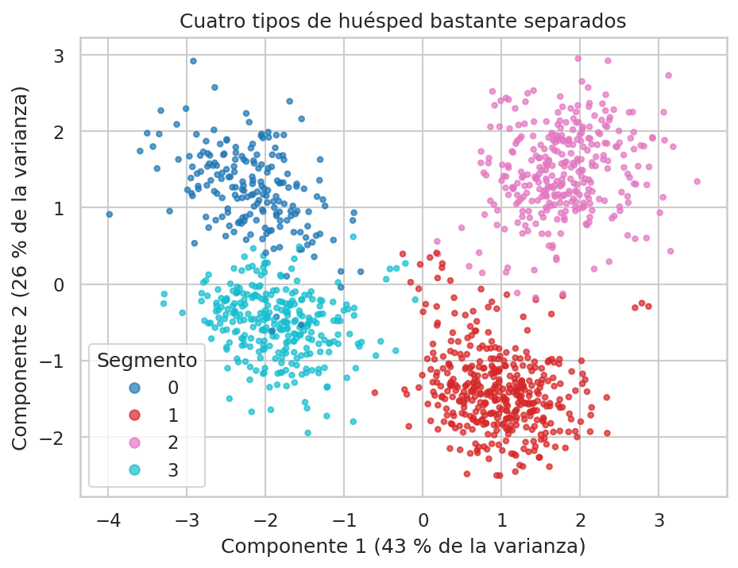

# Ficha de segmentos de huéspedes · TurisData Canarias

**Equipo:** Las Guerreras\
**Fecha:** 17/11/2026\
**Método elegido:** **k-means**\
**Número de segmentos (k):** 4\
**Silueta:** 0,431

## 1. Elección del método y del número de segmentos

Elegimos k-means con cuatro segmentos porque la silueta obtenida es
0,431, un resultado aceptable y ligeramente superior al del clustering
jerárquico (0,424). Desde el punto de vista comercial, cuatro grupos
permiten distinguir perfiles de huéspedes y proponer acciones diferentes
para cada uno.

## 2. Mapa de segmentos (PCA)

El mapa representa los huéspedes en dos componentes principales. La
componente 1 explica el 43 % de la varianza y la componente 2 el 26 %;
juntas conservan aproximadamente el 69 % de la información original. El
gráfico permite observar cuatro agrupaciones diferenciadas, aunque la
representación en dos dimensiones no recoge toda la información de las
siete variables.

## 3. Segmentos identificados

  ---------------------------------------------------------------------------------------
  Segmento    Nombre        Tamaño (n y %) Perfil del        Acción         Experiencia
              comercial                    segmento          comercial      estrella
                                                                            propuesta
  ----------- ------------- -------------- ----------------- -------------- -------------
  0           Escapadas       194 (16,2 %) Edad media: 34,6  Promociones de Observación
              frecuentes                   años; estancia    escapadas      de cetáceos
                                           media: 2,6        cortas,        (nota media
                                           noches; 4         ofertas de     del
                                           reservas al año;  última hora y  prototipo:
                                           gasto medio       propuestas     3,93).
                                           diario: 120,40 €. fáciles de     
                                                             reservar para  
                                                             estancias      
                                                             breves.        

  1           Familias de     402 (33,5 %) Edad media: 40,3  Paquetes       Parque
              larga                        años; estancia    familiares,    acuático
              estancia                     media: 7,4        actividades    (3,68).
                                           noches;           infantiles y   
                                           aproximadamente 9 propuestas     
                                           de cada 10 viajan para           
                                           con niños;        planificar con 
                                           reservan con unos antelación.    
                                           110,3 días de                    
                                           antelación.                      

  2           Mayores de      317 (26,4 %) Edad media: 57,2  Ofrecer        Visita a
              alto gasto                   años; estancia    propuestas     Garachico
                                           media: 8,1        culturales y   (4,21).
                                           noches; gasto     tranquilas,    
                                           medio diario:     comodidad y    
                                           211,40 €; poca    servicios de   
                                           proporción del    mayor valor    
                                           gasto destinada a añadido.       
                                           actividades.                     

  3           Jóvenes         287 (23,9 %) Edad media: 29,3  Promocionar    Parapente
              aventureros                  años; el 74,6 %   aventura,      (3,82).
                                           del gasto se      deporte y      
                                           destina a         actividades al 
                                           actividades.      aire libre,    
                                                             con            
                                                             comunicación   
                                                             visual y       
                                                             digital.       
  ---------------------------------------------------------------------------------------

**Comprobación del tamaño:** 194 + 402 + 317 + 287 = **1.200
huéspedes**.

**Nota sobre las experiencias estrella:** las valoraciones proceden de
un conjunto sintético de 300 usuarios y los segmentos proceden de
`huespedes.csv`. No existe un cruce real entre ambas poblaciones. Por
tanto, las experiencias estrella son **supuestos comerciales
razonados**, apoyados en el perfil de cada segmento y en las notas
medias del prototipo; no demuestran que esos huéspedes concretos hayan
valorado esas experiencias.

## 4. Recomendador de experiencias

### Métodos comparados

El conjunto de valoraciones contiene 300 usuarios y 25 experiencias. Se
compararon dos métodos de recomendación:

  Método           RMSE   precision@3
  ------------- ------- -------------
  Popularidad     1,029         0,125
  Item-item       0,895         0,171

El conjunto se dividió en entrenamiento y prueba: 1.786 valoraciones
para entrenamiento y 446 para prueba. La evaluación contó con 115
usuarios evaluables.

### Método elegido

Elegimos **item-item** porque obtiene un RMSE menor (0,895 frente a
1,029) y una precision@3 mayor (0,171 frente a 0,125). Por tanto, en
esta evaluación predice las notas con menor error y consigue más
aciertos entre las tres primeras recomendaciones.

### Ejemplo de recomendación

Para el usuario 1, el ejemplo de recomendación del prototipo es:

1.  Parque Timanfaya: **4,73**.
2.  Ruta por Anaga: **4,14**.
3.  Zoo y jardines: **3,87**.

Además, se comprobó la función `recomendar()` con tres usuarios. En las
tres pruebas devolvió tres experiencias ordenadas por nota prevista y el
conjunto de recomendaciones ya valoradas fue `set()`. Esto indica que no
se recomendaron experiencias que esos usuarios ya habían puntuado.

**Resultados de las pruebas adicionales:**

-   Usuario 1: Parque Timanfaya (4,73), Ruta por Anaga (4,14) y Zoo y
    jardines (3,87).
-   Usuario 2: Observación de cetáceos (4,55), Astronomía en el Roque
    (4,51) y Parapente (3,90).
-   Usuario 3: Visita a Garachico (5,00), Ruta del queso majorero (4,17)
    y Ruta por Anaga (3,99).

### ¿Qué ocurre con un huésped nuevo?

Si el huésped todavía no tiene valoraciones, no podemos calcular
recomendaciones personalizadas con su historial. En ese caso utilizamos
el método de **popularidad**, que recomienda las experiencias mejor
valoradas por el conjunto de usuarios. Cuando el huésped empiece a
valorar experiencias, podremos utilizar esa información para
personalizar las recomendaciones.

## 5. IA responsable

-   **Riesgo de discriminación en la segmentación:** utilizar la edad o
    el hecho de viajar con niños para cobrar precios diferentes o
    limitar ofertas. **Medida:** usar los segmentos para orientar
    contenidos y propuestas, nunca para establecer precios
    discriminatorios ni excluir clientes.
-   **Riesgo de sesgo de popularidad en las recomendaciones:** mostrar
    repetidamente las experiencias más conocidas y dar poca visibilidad
    a las demás. **Medida:** reservar espacio para experiencias menos
    populares y revisar periódicamente la diversidad de las
    recomendaciones.
-   **Privacidad y datos personales:** las variables analizadas incluyen
    edad, hábitos de reserva, gasto, duración de la estancia y si se
    viaja con niños. **Medida:** recoger solo los datos necesarios,
    limitar los accesos, protegerlos y aplicar seudonimización cuando
    corresponda.
-   **Base legal:** el ejercicio utiliza datos sintéticos. Antes de
    aplicar el sistema a datos reales, la organización debe determinar y
    documentar una base jurídica válida conforme al RGPD, informar a las
    personas y respetar sus derechos.
-   **Supervisión:** las recomendaciones deben servir de apoyo y no
    sustituir el criterio humano; hay que revisar errores, sesgos y
    resultados antes de utilizarlas comercialmente.

## 6. Limitaciones

-   Los datos son sintéticos y pueden no representar el comportamiento
    real de los huéspedes de Canarias.
-   El análisis de huéspedes corresponde a un periodo de un año y no
    permite comprobar cómo cambian los perfiles a largo plazo.
-   En el recomendador, cada usuario dispone de entre 4 y 11
    valoraciones, una cantidad limitada para conocer sus preferencias.
-   Las dos componentes del PCA conservan aproximadamente el 69 % de la
    varianza; el 31 % restante no aparece en el mapa bidimensional.
-   La evaluación del recomendador se realiza con 115 usuarios
    evaluables, por lo que convendría ampliar la muestra.
-   Las valoraciones de experiencias y los perfiles de huéspedes
    pertenecen a conjuntos de datos diferentes. Las experiencias
    estrella son hipótesis comerciales y no asociaciones demostradas.
-   Las métricas obtenidas dependen de esta división concreta entre
    entrenamiento y prueba; sería conveniente repetir la evaluación con
    otras particiones.

## 7. Declaración de uso de inteligencia artificial

Usamos la IA como apoyo para interpretar los resultados, organizar la
información y redactar partes de la ficha. Comprobamos las cifras, las
métricas y las recomendaciones con las salidas del cuaderno. Revisamos y
cambiamos las propuestas para adaptarlas a nuestros resultados y a los
requisitos del reto. No introdujimos datos personales ni claves en la
herramienta.

## 8. Revisión con la rúbrica

**Persona revisora:** Marysol.

### Comprobaciones realizadas

-   **Ejecución del cuaderno:** Marysol realizó «Reiniciar y ejecutar
    todo» y confirmó que no aparecen errores.
-   **Tamaños y perfiles:** confirmó que los cuatro segmentos suman
    1.200 huéspedes y que los nombres comerciales corresponden a sus
    perfiles.
-   **Estandarización:** confirmó que las variables se estandarizan
    antes de aplicar el clustering.
-   **Recomendador:** probó `recomendar()` con los usuarios 1, 2 y 3. En
    los tres casos se obtuvieron tres recomendaciones ordenadas por nota
    prevista y `set()` al comprobar si ya habían sido valoradas.

### Puntuación de la rúbrica

**Pendiente de asignar.** Deben copiarse los cuatro niveles (de 1 a 4)
según los descriptores exactos de la rúbrica oficial y acompañar cada
nivel con una frase de evidencia. No se asigna una puntuación sin
consultar esos descriptores.

  ------------------------------------------------------------------------
  Criterio de la                        Nivel (1--4) Evidencia /
  rúbrica                                            justificación
  --------------------- ---------------------------- ---------------------
  Segmentación y                           3         Marysol comprobó los
  perfilado                                          tamaños, los perfiles
                                                     y la correspondencia
                                                     de los nombres.

  Mapa e interpretación                   3	     Mapa PCA incluido;
                                                     dos componentes
                                                     explican
                                                     aproximadamente el 69
                                                     % de la varianza.

  Recomendador y                           3         Item-item supera a
  evaluación                                         popularidad en RMSE y
                                                     precision@3; probado
                                                     con tres usuarios sin
                                                     recomendar
                                                     experiencias ya
                                                     valoradas.

  Comunicación, IA                         3         Ficha completada con
  responsable y entrega                              riesgos, medidas,
                                                     limitaciones y
                                                     declaración de uso de
                                                     IA.
  ------------------------------------------------------------------------

**Primera mejora propuesta:** ampliar los datos y repetir la evaluación
para comprobar si los segmentos y las recomendaciones se mantienen con
nuevas muestras y otros periodos.

